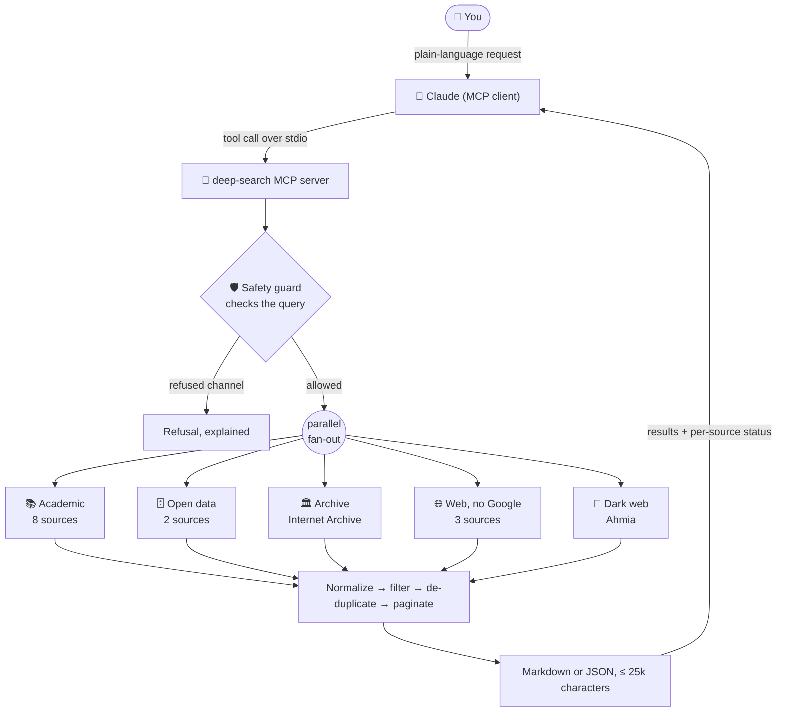
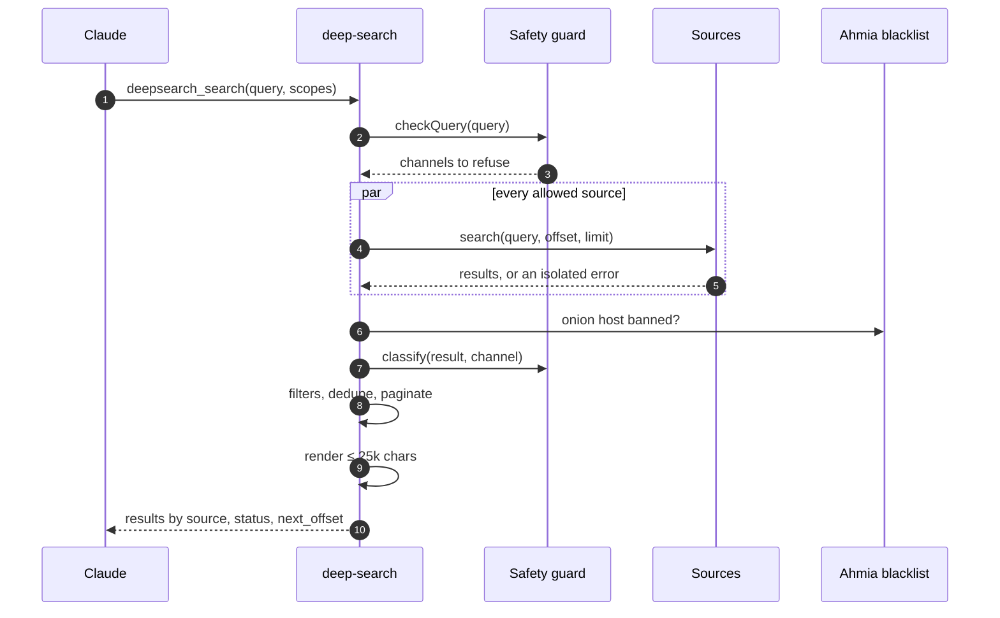
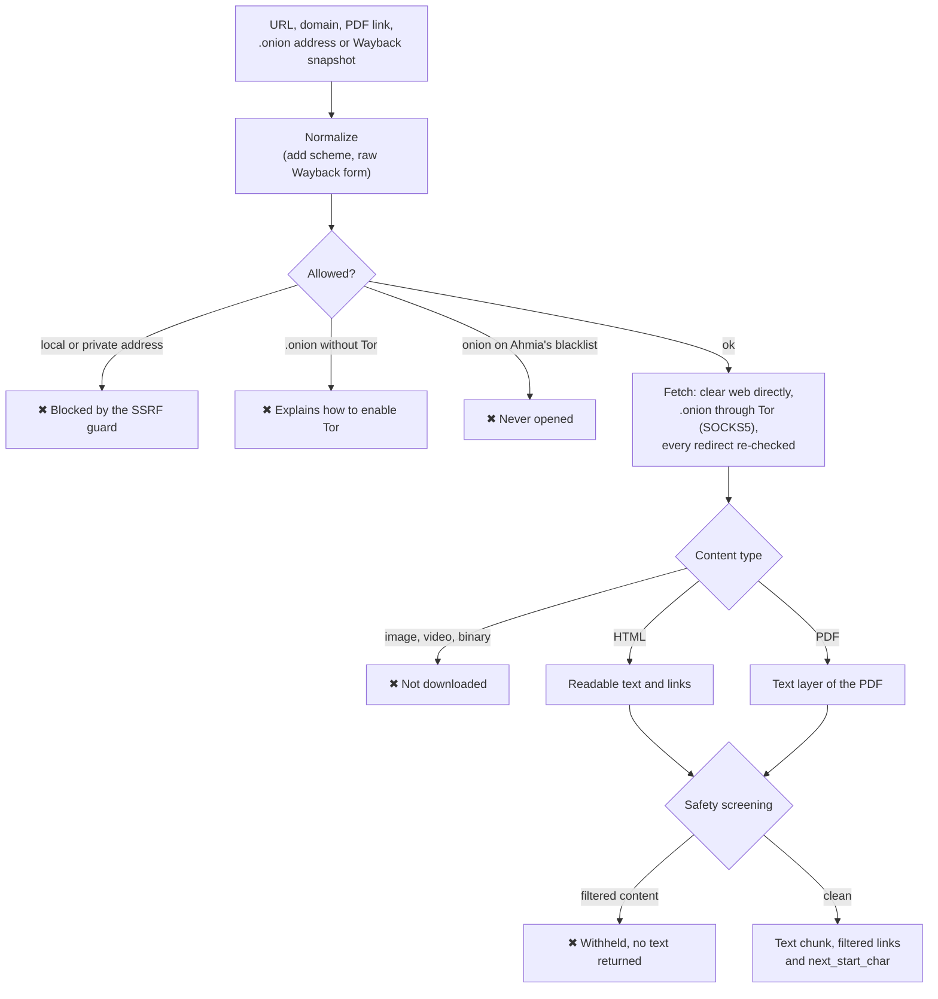

<div align="center">

# 🔎 Deep Search MCP

**Research beyond Google: academic databases, open data, web archives, independent search engines and the Tor dark web, behind a safety filter that never switches off.**


[Why](#-why) · [Information flow](#-information-flow) · [Example](#-example) · [Tools](#-tools) · [Sources](#-sources) · [Safety](#-safety-model) · [Install](#-installation) · [Configuration](#-configuration) · [Development](#-development)

</div>

---

## 💡 Why

Mainstream search engines rank for popularity and commerce. A lot of valuable material never makes it to page one:

- theses, preprints and open-access versions of paywalled papers sitting in university repositories;
- datasets, reports and other grey literature that journals never index;
- small, independent and personal websites that big engines bury;
- pages that were deleted or quietly rewritten;
- what is being said on Tor onion services.

**Deep Search** is a [Model Context Protocol](https://modelcontextprotocol.io) server that gives Claude (or any MCP client) one tool to search all of that at once, tools to read what it finds (HTML, PDF, `.onion`) and to recover old versions of pages. Every query, result and page goes through a safety layer, so research on sensitive subjects stays possible without surfacing abusive content.

## ✨ Highlights

| | |
|---|---|
| 🌐 **17 sources, 5 scopes** | Academic, open data, archives, independent web (no Google) and dark web, in parallel, in one call |
| 📑 **Citable results** | DOI, open-access PDF links, authors, year, venue and citation counts when the source has them |
| 🧩 **Robust by design** | One failing source never fails the search; duplicates are merged across sources by DOI/URL |
| 📖 **Reads what it finds** | HTML to clean text, PDF text extraction, `.onion` pages through Tor, Wayback snapshots |
| 🛡️ **Safety that cannot be turned off** | 11 filter categories, 3 permanently locked, Ahmia's abuse blacklist, SSRF protection |
| 🤝 **Plays fair** | Honest User-Agent, respects rate limits, never solves or bypasses CAPTCHAs |

## 🔀 Information flow

### Overview



### Anatomy of a search



### Reading a page



## 🧪 Example

**You ask Claude:** *"Find research on post-quantum cryptography, and check what onion sites are saying about it."*

**Claude calls the tool with this input:**

```json
{
  "tool": "deepsearch_search",
  "arguments": {
    "query": "post-quantum cryptography",
    "scopes": ["academic", "web", "darkweb"],
    "limit_per_source": 2
  }
}
```

**Output** (real run, shortened: abstracts replaced by placeholders, onion addresses abbreviated, `…` marks omitted sources):

```markdown
# Deep Search: "post-quantum cryptography"
Scopes: academic, web, darkweb · up to 2 per source
**Safety filter:** 3 results hidden (Hacking & malware services: 1, Fraud, carding & stolen data: 1, Violence for hire: 1).

## Academic literature

### OpenAlex — 2 of 53,349
1. **Post-quantum cryptography** (2017)
   Daniel J. Bernstein, Tanja Lange · Nature · article · cited 1,397× · open access · en
   https://doi.org/10.1038/nature23461
   PDF: https://research.tue.nl/nl/publications/5bbd4ea6-f4a5-452c-b9aa-f535cd8f4a50
2. **Post-Quantum Cryptography** (2009)
   Daniel J. Bernstein, Johannes A Buchmann, Erik Dahmen · Springer eBooks · book · cited 839× · en
   https://doi.org/10.1007/978-3-540-88702-7

### arXiv — 2 of 1,070
…
2. **Towards post-quantum blockchain: A review on blockchain cryptography resistant to quantum computing attacks** (2024)
   Tiago M. Fernandez-Carames, Paula Fraga-Lamas · arXiv cs.CR · preprint · open access
   https://arxiv.org/abs/2402.00922v1
   PDF: https://arxiv.org/pdf/2402.00922v1
   > (abstract snippet)

### BDTD — 2 of 37
1. **Attacking and defending post-quantum cryptography candidates** (2022)
   Paiva, Thales Areco Bandiera · BDTD (Brazilian theses & dissertations) · doctoral thesis · open access · eng
   https://bdtd.ibict.br/vufind/Record/USP_ff089afa0775bd5e3004182a245cdfd8
   > (abstract snippet)
…

## Independent web search (no Google)

### Marginalia Search — error: Marginalia's shared 'public' API key is over its rate limit. A free personal key (e-mail contact@marginalia-search.com) set as MARGINALIA_API_KEY avoids this.

### DuckDuckGo — 2 of 10
1. **Post-Quantum Cryptography | CSRC**
   https://csrc.nist.gov/projects/post-quantum-cryptography
   > NIST's Post-Quantum Cryptography (PQC) project leads the national and global effort…
…

## Dark web (Tor onion services)

### Ahmia — 2 of 172 · 3 hidden by safety filter
1. **Blog Stéphane Bortzmeyer: RFC 9958: Post-Quantum Cryptography for Engineers**
   sjnrk23r…s3eyid.onion · last seen Nov. 1, 2026, 7:55 a.m.
   http://sjnrk23r…s3eyid.onion/9958.html
2. **Quantum Computing Spurs Urgency on Cryptography Upgrades**
   wgruul6c…zcx3yd.onion · last seen Nov. 2, 2026, 12:49 a.m.
   http://wgruul6c…zcx3yd.onion/quantum-computing-spurs-urgency-on-cryptography-upgrades

> .onion links only open through Tor. deepsearch_fetch_page can read them when DEEP_SEARCH_TOR_PROXY is configured. Treat dark web content as unverified.

---
1 source(s) failed; the rest are shown.
More results: call again with offset=2.
```

Things to notice: the filter hid three dark web listings (hacker-for-hire, carding and violence-for-hire spam that piggybacks on popular keywords), one rate-limited source failed without breaking the search, and the footer tells Claude how to get the next page.

<details>
<summary><b>Same search with <code>"response_format": "json"</code></b> (abridged)</summary>

```json
{
  "query": "post-quantum cryptography",
  "scopes": ["academic", "web", "darkweb"],
  "offset": 0,
  "limit_per_source": 2,
  "sources": [
    { "id": "openalex", "name": "OpenAlex", "scope": "academic", "status": "ok", "count": 2, "total": 53349, "has_more": true, "hidden": 0, "duplicates": 0 },
    { "id": "marginalia", "name": "Marginalia Search", "scope": "web", "status": "error", "count": 0, "has_more": false, "hidden": 0, "duplicates": 0, "error": "Marginalia's shared 'public' API key is over its rate limit. …" },
    { "id": "ahmia", "name": "Ahmia", "scope": "darkweb", "status": "ok", "count": 2, "total": 172, "has_more": true, "hidden": 3, "duplicates": 0 }
  ],
  "results": [
    {
      "source": "openalex",
      "title": "Post-quantum cryptography",
      "url": "https://doi.org/10.1038/nature23461",
      "authors": ["Daniel J. Bernstein", "Tanja Lange"],
      "year": 2017,
      "venue": "Nature",
      "doi": "10.1038/nature23461",
      "pdf_url": "https://research.tue.nl/nl/publications/5bbd4ea6-f4a5-452c-b9aa-f535cd8f4a50",
      "open_access": true,
      "type": "article",
      "citations": 1397,
      "language": "en"
    }
  ],
  "safety": {
    "hidden": 3,
    "by_reason": { "hacking_services": 1, "fraud": 1, "violence_for_hire": 1 },
    "refused": [],
    "banned_list_loaded": true
  },
  "has_more": true,
  "next_offset": 2
}
```

The JSON text is sent compact (no indentation) and the same object is returned as MCP `structuredContent`.

</details>

**More things to ask:**

- *"Survey studies on glyphosate and cancer since 2015, including Brazilian theses."*
- *"This government page was taken down. Show me its archived versions and what changed."*
- *"Find independent blogs about the history of computing in Brazil, excluding Wikipedia."*
- Run the **`deepsearch_investigate`** prompt with a topic for a guided, cited investigation.

## 🧰 Tools

| Tool | What it does | Key parameters |
|---|---|---|
| `deepsearch_search` | Meta-search across sources and scopes; results grouped by source with per-source status | `query`, `scopes`, `sources`, `limit_per_source` (1–25, default 5), `offset`, `year_from`, `year_to`, `exclude_domains`, `response_format` |
| `deepsearch_fetch_page` | Reads a page as clean text: HTML, PDF, `.onion` (via Tor) or Wayback snapshot; long pages come in chunks | `url`, `max_chars` (≤ 20k), `start_char`, `include_links` |
| `deepsearch_archived_versions` | Lists Wayback Machine captures of a URL, path or domain, with view and raw links | `url`, `match` (exact, prefix, host, domain), `from`, `to`, `limit`, `newest_first` |
| `deepsearch_list_sources` | Lists sources, what each needs, Tor status and the active safety policy | `response_format` |
| `deepsearch_investigate` *(prompt)* | Guided investigation: search every scope, read sources, cross-check, cited report | `topic`, `focus` |

All tools are read-only and support `"response_format": "markdown"` (default) or `"json"`.

## 📚 Sources

| Scope | Source | What it brings | Needs |
|---|---|---|---|
| academic | **OpenAlex** | ~250M scholarly works with open-access links | nothing (key optional) |
| academic | **CORE** | ~300M open-access papers from institutional repositories; free versions of paywalled articles | nothing (free key lifts limits) |
| academic | **Crossref** | Metadata of ~170M DOIs, including SSRN, book chapters and reports | nothing |
| academic | **SciELO** | Brazilian and Latin American journals | nothing |
| academic | **Europe PMC** | Life sciences and health: all of PubMed/MEDLINE plus PMC full texts | nothing |
| academic | **arXiv** | Preprints in physics, maths, computer science, economics and more | nothing |
| academic | **DOAJ** | Fully open-access, peer-reviewed journals | nothing |
| academic | **BDTD (IBICT)** | Theses and dissertations from Brazilian universities | nothing |
| academic | Semantic Scholar | Scholarly search with citation counts | API key (on request without one) |
| data | **DataCite** | Datasets with DOIs (Zenodo, Figshare, Dryad, Dataverse…) | nothing |
| data | **Zenodo** | Datasets, software, reports and other grey literature | nothing |
| archive | **Internet Archive** | Digitized books, documents, magazines, audio and video | nothing |
| web | **Marginalia** | Independent index that favors small, non-commercial sites | nothing (public key is often rate-limited) |
| web | **Wiby** | The "classic" lightweight personal web | nothing |
| web | **DuckDuckGo** | General web search without Google (first page only) | nothing |
| web | Brave Search | Brave's own independent index | `BRAVE_API_KEY` |
| darkweb | **Ahmia** | Index of Tor onion services that removes abuse content | nothing (Tor optional) |

**Bold** sources run by default. The others run when their key is set, or when requested through the `sources` parameter.

## 🛡️ Safety model

The filter is a core part of the project and **cannot be switched off entirely**.

**Locked categories** (no configuration can disable them):

| Category | Covers | Behavior |
|---|---|---|
| `csam` | Child sexual abuse material and its trade slang | Query refused on web and dark web; results and pages always hidden |
| `exploitation` | Human and organ trafficking, sexual slavery, leaked or covert intimate imagery, deepfake nudes | Results hidden; refused on the dark web |
| `mass_harm` | Instructions for bombs, explosives, chemical or biological weapons | Query refused on web and dark web |

**Configurable categories** (on by default): `sexual`, `gore`, `violence_for_hire`, `weapons`, `drugs`, `fraud`, `hacking_services`, `extremism`. They target **listings and transactions** ("buy cocaine", "guns for sale", "hacker for hire"), not topics, so news and research about those subjects still come through.

**Channels**: every source and page is screened according to where it comes from.

| Channel | Applies to | Rules |
|---|---|---|
| `academic` | Scholarly metadata, and pages on publisher or repository hosts | Only unambiguous abuse slang, so research *about* sensitive topics stays readable |
| `web` | Web search engines, Internet Archive, clear-web pages | Every active category |
| `darkweb` | Ahmia results, `.onion` pages | Every active category, plus topic rules and the blacklist |

**Other protections:**

- **Ahmia's blacklist**: ~60,000 onion domains banned for abuse are dropped from results and never opened. Onion pages are not opened at all if the list cannot be loaded (fail-closed).
- **Text only**: pages are read as text; images, video and downloads are never fetched. A page dominated by filtered content is withheld.
- **SSRF guard**: `localhost`, private networks and cloud metadata endpoints are refused, including after redirects.
- **No evasion**: the client identifies itself as `deep-search-mcp` on the clear web and never solves or bypasses CAPTCHAs or bot checks. Over Tor it uses the Tor Browser User-Agent, to stay in its anonymity set.
- **A refusal is final**: tool descriptions tell the model not to rephrase a query to get around a refusal.

> [!NOTE]
> The filters are heuristic. They greatly reduce exposure but are not perfect: use the tool responsibly and within the law.

## 📦 Installation

Requires **Node.js 20.18+**.

```bash
git clone https://github.com/Edx0n/deep-search-mcp.git
cd deep-search-mcp
npm install
npm run build
```

**Claude Code**

```bash
claude mcp add --scope user deep-search -- node /path/to/deep-search-mcp/dist/index.js
```

With environment variables (Tor in this example):

```bash
claude mcp add --scope user deep-search -e DEEP_SEARCH_TOR_PROXY=socks5h://127.0.0.1:9150 -- node /path/to/deep-search-mcp/dist/index.js
```

**Claude Desktop**: add to `claude_desktop_config.json`:

```json
{
  "mcpServers": {
    "deep-search": {
      "command": "node",
      "args": ["/path/to/deep-search-mcp/dist/index.js"],
      "env": {
        "DEEP_SEARCH_TOR_PROXY": "socks5h://127.0.0.1:9150"
      }
    }
  }
}
```

On Windows, write the path as `C:\\path\\to\\deep-search-mcp\\dist\\index.js` in JSON (or use forward slashes).

## ⚙️ Configuration

Every variable is optional; see [`.env.example`](.env.example).

| Variable | Purpose |
|---|---|
| `DEEP_SEARCH_TOR_PROXY` | Tor SOCKS5 proxy, e.g. `socks5h://127.0.0.1:9150` (Tor Browser) or `:9050` (tor service). Needed to **read** `.onion` pages. |
| `DEEP_SEARCH_AHMIA_MODE` | `auto` (default: Ahmia's onion mirror when Tor is set), `clearnet` or `onion`. |
| `DEEP_SEARCH_DISABLED_FILTERS` | **Configurable** categories to turn off, e.g. `drugs,fraud` (useful for threat intelligence). Locked categories are ignored. |
| `OPENALEX_API_KEY` | Free OpenAlex key; without it there is a small daily budget shared per IP. |
| `CORE_API_KEY` | Free CORE key; the anonymous limit is low. |
| `SEMANTIC_SCHOLAR_API_KEY` | Turns Semantic Scholar on by default. |
| `MARGINALIA_API_KEY` | Free personal Marginalia key (requested by e-mail); the public key is usually rate-limited. |
| `BRAVE_API_KEY` | Turns Brave Search on. |
| `DEEP_SEARCH_CONTACT_EMAIL` | Contact for the Crossref/OpenAlex "polite pool". Only sent if you set it. |
| `DEEP_SEARCH_TIMEOUT_MS` / `DEEP_SEARCH_TOR_TIMEOUT_MS` | Timeouts (default 20 s / 60 s). |

### 🧅 Tor (optional)

Dark web **search** works without Tor (through `ahmia.fi`). Tor is needed to **read** `.onion` pages and to search through Ahmia's own onion mirror.

- **Tor Browser**: open it and keep it running; the proxy is `socks5h://127.0.0.1:9150`.
- **tor service** (Tor Expert Bundle from torproject.org): run `tor`; the proxy is `socks5h://127.0.0.1:9050`.

Use `socks5h` so that `.onion` names are resolved by Tor, never by your DNS.

## 🛠️ Development

```bash
npm test
```

```bash
npm run build && npm run smoke
```

```bash
npm run live -- "your query"
```

- `npm test`: unit tests without network. Covers the safety rules (including a false-positive suite), every source parser, the HTTP client against a simulated SOCKS5/Tor proxy, HTML extraction, the search orchestrator and output sizing.
- `npm run smoke`: end-to-end check. Starts the built server over stdio like an MCP host and calls every tool against the real services.
- `npm run live`: runs each source once and prints status, counts and timing.

```
src/
├── index.ts / server.ts   stdio entry point, tools and prompt (MCP SDK v2, Zod 4)
├── search.ts              orchestrator: selection, refusal, fan-out, filter, dedupe, pagination
├── format.ts              Markdown/JSON rendering under 25k characters
├── http/                  undici client (SSRF guard, Tor via SOCKS5, size limits)
├── safety/                rules, normalization, guard, Ahmia blacklist, scholarly hosts
├── sources/               one parser + search() per source, grouped by scope
├── extract/               HTML → text + links, PDF → text
└── tools/                 page reader and Wayback lookup
```

Design notes and trade-offs: [`docs/DESIGN.md`](docs/DESIGN.md).

## ⚠️ Known limitations

- **Rate limits**: Semantic Scholar and Marginalia's public key are usually exhausted; anonymous CORE and Crossref (1 request/s, already queued) have quotas too. Free keys solve it.
- **DuckDuckGo**: first page only. It may answer with a bot check, in which case the source reports an error and the others carry on.
- **Ahmia**: broad queries return thousands of results and take around 10 seconds. Onion services are often slow or offline.
- **Strict on the open web**: clear-web pages *about* child abuse (news, encyclopedias) are withheld as well. Use the `academic` scope to research the subject.
- **Scanned PDFs** without a text layer (no OCR) yield no text.

<details>
<summary><b>Sources considered but not included</b></summary>

- **Torch, Haystak and similar onion engines**: Torch's widely shared addresses are v2 onions (retired in 2021), Haystak's circulate in a malformed form and, above all, these indexes do **not** filter abuse content. Ahmia is the only one with a maintained blacklist.
- **BASE** requires registering your IP address to use its API.
- **OATD**, **SciELO's own search** and **Internet Archive Scholar** block automated access (SciELO is covered through Crossref).
- **Mojeek** answers automated requests with a CAPTCHA, which this project does not bypass.

</details>

## 🤝 Responsible use

This is a tool for research, journalism and OSINT. Accessing Tor may be legal where you live, but what you open and what you do with it is your responsibility. Do not use this project to obtain, distribute or facilitate illegal content or activities.

## 📄 License

[MIT](LICENSE) © Edx0n
